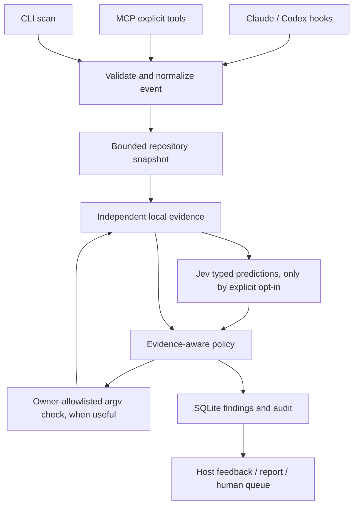

# Architecture

The executable bundles three entry points: CLI, daemon, and stdio MCP. Packages remain independent source modules with no integration-specific decisions inside the evidence collectors.

## Evidence and claims

`AgentEvent` and explicit claims are validated with Zod. Structured requests identify exact evidence requirements. The compiler generates narrow inspection assertions for a scan: import resolution and absence of file-scoped diagnostics. These are HALLUCHECK inspection assertions, not invented agent statements. Free text is retained verbatim as one `limited` extraction, with no guessed evidence requirements. This intentionally leaves broad completion statements NOT_CHECKED.

Evidence collectors distinguish VERIFIED, CONTRADICTED, UNSUPPORTED, and NOT_CHECKED. A reliable contradiction wins over other observations. Every required fact must have reliable direct support for an aggregate VERIFIED status. A local documentation excerpt proves its presence only; symbol existence proves presence only. Model probabilities never establish factual truth.

The compiler host is read-only and confines project reads to the canonical repository. It permits the installed TypeScript standard libraries and in-repository dependency definitions. Configured compiler plugins are disabled. Compiler programs are bounded and keyed by source snapshot, selected roots, and dependency lookup metadata. Missing candidate paths are tracked so later dependency installation invalidates previous resolution results.

## Model and policy

Jev is the sole probabilistic provider in production. Four questions per claim are batched, up to five claims / twenty questions per request. Noul probability, choice distribution/confidence, and decimal score/distribution remain distinct. The actual model build, provider request ID, and latency are retained.

Routing selects one primary action. Mandatory authorization precedes everything. Direct contradiction requests advisory repair. Direct support permits continuation of that exact assertion. Missing evidence can trigger a cheap owner-configured check. Provisional expected error cost is `incorrectRisk * (1 + impact)^2`; verification and human interruption costs are configurable policy units, not calibrated money or calibrated probability estimates. An outage is explicitly recorded and never converted into a model prediction. Low-consequence unsupported assertions may continue with their uncertainty intact.

Offline mode provides objective evidence and policy only. It does not substitute keyword rules or a pretend local model. Test mocks are explicit `mock` providers with `mock-fixture-v1` versions.

## Test execution and trust

The executor runs only exact argv arrays from local owner-reviewed configuration, with `shell:false`, a minimal environment, process-group cancellation, deadlines, concurrency bounds, and a 64 KB combined output cap. It never executes event commands, model recommendations, or generated repair instructions.

Each independently run check records the command, time, exit code, completion, skip contract, and source snapshot before execution. The repository is checked again afterwards. Unknown skip status, cancellation, incomplete discovery, or later source changes prevent verification. `provesNoSkippedTests` is an explicit owner assertion about a configured command, suitable for a wrapper that fails on skipped tests; it must not be set for an ordinary runner that can silently skip.

Hook-supplied tool observations are separately audited as untrusted. A host JSON success string is not promoted to independently executed test evidence. The MVP does not cryptographically authenticate hook processes or infer test-suite coverage from arbitrary shell output.

## Persistence and performance

SQLite uses WAL, bound queries, and a busy timeout. Repository state and sockets have private permissions. Findings have stable content/state identities; rerunning the same scoped assertion does not grow duplicate rows. Model/decision caches are bounded with a short TTL. Execution records participate in result cache keys.

The warm analyzer caches directory listings and content hashes. Directory metadata detects additions/deletions, including files added to previously empty directories. File inode/size/mtime/ctime detects modifications before reusing a hash. No file contents are re-read when these identities are unchanged. Periodic and host-edit-triggered rediscovery use ripgrep with fixed arguments. Snapshot construction still walks cached metadata and runs bounded Git queries; performance is proportional to the bounded repository size, not constant time.

The daemon holds these caches across events. Its Unix socket protocol accepts one bounded JSON frame per connection. A bounded queue cancels superseded work by caller key and retains at most 256 completed outcomes. In-flight checks receive AbortSignals; the compiler's synchronous pass cannot be interrupted mid-call. MCP and CLI connect to an existing daemon and otherwise use the same engine directly.

## Extension points

`EvidenceCollector`, `DecisionProvider`, and host capability declarations separate language, inference, and host behavior. External official documentation retrieval has a reserved provider boundary but no implemented web search. Rust acceleration could replace snapshot/analysis collectors without changing events, evidence statuses, or policy inputs.

## Native interaction extension

FindingInteractionService reuses the engine and SQLite store. Evidence status remains separate from lifecycle state. Durable presentations, repairs and mode preferences are new tables; the original findings and audit history are preserved. Host adapters render conversation warnings and negotiate MCP form choices. UserPromptSubmit provides explicit native user commands without a separate UI. Repair requests carry actual evidence into the invoking session, and completion runs the original collectors again. No plugin code edits project source. Attempts are bounded per claim lineage across snapshots. See [native interaction](NATIVE_INTERACTION.md) for host visibility, action authorization and cancellation semantics.
